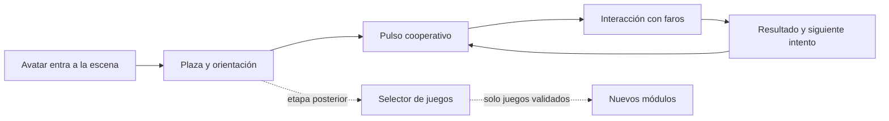

<div align="center">

# 🕹️ Decentraland Social Arcade

### 🎮 Una experiencia 3D social nativa de Decentraland · SDK7 · Creator Hub · TypeScript

**Un juego insignia primero. Una arquitectura multijuego cuando exista evidencia para crecer.**

</div>

---

## Estado actual

| Área                      | Estado         | Alcance verificable                                              |
| ------------------------- | -------------- | ---------------------------------------------------------------- |
| Escena SDK7               | 🟡 Pre-alpha   | Parcela 1×1, punto de aparición, plaza y tres faros interactivos |
| Juego insignia            | 🧪 Prototipo   | `Pulso cooperativo`, interacción local inicial                   |
| Multijuego                | 🧱 Preparado   | Contrato y registro modular; no se anuncian juegos inexistentes  |
| Multijugador sincronizado | ⚪ Planificado | Requiere definir arquitectura de estado compartido               |
| Despliegue público        | ⚪ Pendiente   | No existe todavía una URL publicada                              |

> Este repositorio **no es un juego web convencional**. Es el código fuente de una escena para
> ejecutarse, probarse y desplegarse en Decentraland mediante Creator Hub, Explorer y SDK7.

## Qué se está construyendo

`Decentraland Social Arcade` será una plaza social donde el avatar descubre desafíos breves. La
primera entrega se concentra en **Pulso cooperativo**, un prototipo de faros interactivos que permite
validar navegación, señalización, interacción y ritmo antes de añadir sincronización entre personas.

La arquitectura admite un catálogo posterior, pero el producto inicial no será un menú vacío lleno
de promesas. Cada juego futuro deberá aportar una razón social distinta y superar criterios de
rendimiento, accesibilidad y retención.



## Decisión de producto: uno ahora, varios después

Crear muchos juegos desde el inicio multiplicaría arte, lógica, pruebas, instrucciones y estado
multijugador antes de comprobar si el bucle principal funciona. Crear un repositorio rígido para un
solo minijuego haría costoso crecer. La solución adoptada combina ambas necesidades:

- **Una escena y un juego insignia en el MVP.**
- **Un registro modular** que desacopla cada juego del arranque de la escena.
- **Un menú multijuego condicionado**, no incluido hasta tener al menos dos juegos jugables.
- **Un repositorio por experiencia desplegable**; un workspace superior solo cuando varias escenas
  realmente deban previsualizarse juntas.

La justificación completa está en [ADR-0001](docs/decisions/0001-un-juego-arquitectura-multijuego.md).

## Estructura

```text
decentraland-social-arcade/
├── src/                     # ECS, escena y juegos
│   ├── core/                # Contratos y registro de juegos
│   ├── games/               # Un módulo por experiencia
│   └── scene/               # Entorno compartido de la plaza
├── tests/                   # Pruebas unitarias independientes del motor
├── design/                  # GDD y criterios de experiencia
├── docs/                    # Arquitectura, desarrollo, alcance y despliegue
├── scripts/                 # Validaciones reproducibles del repositorio
├── .github/workflows/       # CI, seguridad y revisión documental
├── scene.json               # Metadatos y parcela de Decentraland
└── src/index.ts             # Punto de entrada SDK7
```

## Inicio rápido

### Requisitos

- Node.js **22 LTS**. Node 24 no se considera soportado por la CLI usada actualmente.
- `pnpm` 11.
- Creator Hub para el flujo visual; VS Code es opcional para código.

```bash
corepack enable
pnpm install
pnpm check
pnpm start
```

`pnpm start` abre la previsualización de la escena con las herramientas oficiales de Decentraland.
Consulta [Desarrollo local](docs/DESARROLLO.md) para trabajar desde Creator Hub o terminal.

## Comandos

| Comando           | Propósito                                                          |
| ----------------- | ------------------------------------------------------------------ |
| `pnpm start`      | Ejecutar la escena en modo de desarrollo                           |
| `pnpm build`      | Generar el bundle compatible con Decentraland                      |
| `pnpm check`      | Ejecutar validación, documentación, lint, tipos, pruebas y formato |
| `pnpm test`       | Probar contratos de dominio                                        |
| `pnpm docs:check` | Verificar enlaces internos y archivos documentales                 |

## Documentación

- [Alcance y límites](docs/ALCANCE.md)
- [Arquitectura](docs/ARQUITECTURA.md)
- [Desarrollo local](docs/DESARROLLO.md)
- [Despliegue](docs/DESPLIEGUE.md)
- [GDD de Pulso cooperativo](design/gdd.md)
- [Hoja de ruta](ROADMAP.md)
- [Contribución](CONTRIBUTING.md)
- [Seguridad](SECURITY.md)

## Fuente de verdad Decentraland

El proyecto sigue la documentación oficial en español, especialmente
[Incorporación a Studio](https://docs.decentraland.org/creator/content-creator-es/studio-onboarding),
[Crear escenas](https://docs.decentraland.org/creator/development-guide/sdk7/create-project) y la guía de
Creator Hub. Si este repositorio contradice una restricción actual de la plataforma, prevalece la
documentación oficial y debe abrirse una incidencia para actualizar el proyecto.

## Privacidad, economía y alcance público

- El prototipo no solicita permisos, cartera, correo ni datos personales.
- No incluye pagos, NFT, recompensas tokenizadas ni mecánicas de azar.
- No promete compatibilidad móvil o VR hasta validarla en clientes oficiales.
- Publicar el código bajo MIT no publica automáticamente la escena en LAND o Worlds.

## Licencia

Código bajo [MIT](LICENSE). Los recursos visuales o sonoros futuros deberán registrar su licencia en
`docs/LICENCIAS-DE-CONTENIDO.md` antes de incorporarse.

---

<div align="center">

**Explorar · cooperar · aprender · construir con límites claros**

</div>
