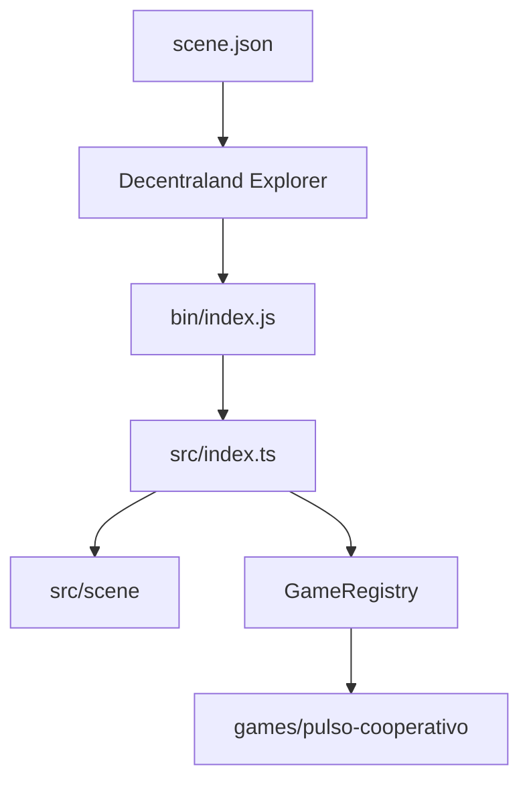

# Arquitectura

## Contexto Decentraland

La unidad desplegable es una escena. `scene.json` declara su parcela, punto de aparición, metadatos y
permisos; `src/index.ts` exporta `main()`, que crea las entidades ECS. El cliente de Decentraland
ejecuta el bundle generado por la CLI oficial.

## Capas

### Escena compartida

`src/scene` contiene suelo, orientación, decoración y elementos comunes. No debe contener reglas
específicas de un juego.

### Núcleo

`src/core` define el contrato mínimo `ArcadeGame` y el registro. El contrato protege ids, duración y
número mínimo de participantes. La intención es permitir un selector posterior sin acoplarlo a clases
concretas.

### Juegos

Cada carpeta bajo `src/games` contiene una actividad. Un módulo puede crear entidades, sistemas y UI,
pero debe exponer un objeto que cumpla `ArcadeGame`. La primera implementación usa primitivas para no
introducir licencias o peso de assets antes de validar el diseño.

## Estado multijugador

El estado local de ECS no equivale a estado compartido. Para la fase cooperativa se elaborará otro ADR
comparando sincronización serverless, servicio autoritativo y tolerancia a desconexiones. Hasta entonces,
el README y el GDD describen la experiencia como prototipo local.

## Presupuestos a establecer

Antes de V1 se registrarán límites verificables de triángulos, materiales, texturas, audio, entidades,
tamaño descargable y tiempo de carga conforme a la documentación vigente. No se copian aquí cifras
que puedan quedar obsoletas; la fuente de verdad será la documentación oficial enlazada en el README.
